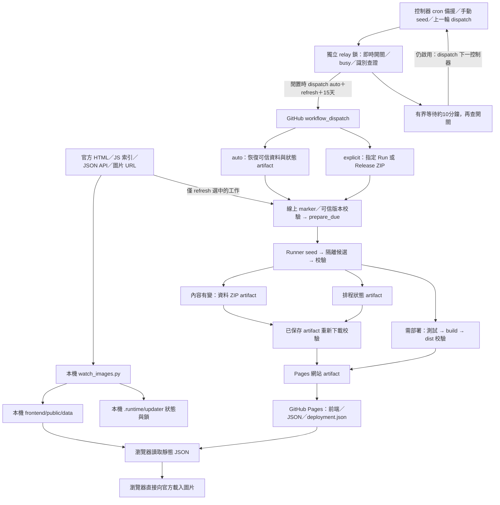

# 資料來源、更新流程與恢復保護

- 盤點日期：2026-11-06（Asia/Taipei）。
- 程式基準：`main`，commit `903c7caeaf1f49931ebe0463ae85e2a8887a69cb`，加上本批獨立接力控制器；此 SHA 是實作前基準。第 13 節描述程式行為，線上啟用與驗收結果另記本機 HANDOFF。
- 依據：直接閱讀入口、Services、發布／快照、workflow 與前端程式；隔離真來源結果見第 8 節，先前手動雲端結果見本機 HANDOFF 第 14 節及本文第 11 節的界線摘要。
- history v2 與先前來源／恢復修正維持不變。本批只實作接力入口、停止與去重保護，沒有改各圖資到期、歷史或保存政策（保存政策於 2026-11-10 另行調整，見第 4 節保存政策現況）。第 12 節保留先前 cron 直接入口紀錄；接力線上驗收須有真實 run 證據，不把模擬事件當作接力成功。
- **維護要求：之後修改資料流、Fetcher、恢復／發布或前端讀取行為時，應同步更新本文件、盤點日期與程式基準。**

HANDOFF.md 與本機 .runtime 驗收證據不納入版本控制；相關連結供本機維護使用。

本文件供維護與新 chat 建立整體認識，不授權抓取、commit、push、部署或啟用排程。以下「現況」代表已有程式，不代表所有來源或失敗邊界都已線上驗收。「已知問題」與「提案」另行標記。

## 1. 整體資料流（現況）

關鍵區別：

- 抓取成功、內容改變、部署成功是三個不同結果。有效舊 JSON 能顯示，不代表本輪來源成功。
- 只保存 JSON、網址及必要雜湊，不歸檔圖片本體。JSON 備援不能保證官方歷史圖片長期可用。
- 網頁重新整理只讀已發布資料，不觸發 Fetcher。本機 JSON 更新也不會自行更新遠端 Pages。
- 本機直接更新與雲端 due 流程共用 Service，但到期策略、歷史探查與保護層不同。

## 2. 各圖資來源與抓取方式（現況）

下列 URL 模板中的時間由程式組合；防快取參數省略。來源設定不代表盤點當日已實測可用。JS 僅以 regex 解析資料，不執行上游程式。

| 圖資 | 實際請求的來源／圖片 URL | 選擇最新資料與時間解析 | 圖片讀取與特殊處理 | 程式 |
| --- | --- | --- | --- | --- |
| radar | `https://www.cwa.gov.tw/Data/js/obs_img/Observe_radar.js` → `https://www.cwa.gov.tw/V8/C/W/OBS_Radar.html` → `/Data/radar/CV1_3600_{YYYYMMDDHHmm}.png` 時間探查 | 各索引內按檔名台北時間由新到舊驗圖，無有效候選再走下一方法；最後現在減 20 分鐘、10 分鐘格，最多 36 候選。重複 URL 略過。 | 候選 404／410 續查；故障／無效圖片停止。另建當日 history。 | [CWAService](../fetchers/src/services/cwa_service.py)、[current_day](../fetchers/src/current_day.py) |
| satellite | `https://www.cwa.gov.tw/Data/satellite/LCC_IR1_CR_2750/LCC_IR1_CR_2750-{YYYY-MM-DD-HH-mm}.jpg` | 不先讀 HTML／索引。現在減 30 分鐘、對齊 10 分鐘格，倒查約 6 小時，首張可用即採用；時間來自候選台北時刻。 | 驗圖並建當日 history；來源頁 `OBS_Sat.html` 是 metadata 連結。 | [CWAService](../fetchers/src/services/cwa_service.py)、[current_day](../fetchers/src/current_day.py) |
| rainfall | `https://www.cwa.gov.tw/Data/js/rainfall/RainfallImg_Day.js` → `https://www.cwa.gov.tw/V8/C/P/Rainfall/Rainfall_QZJ.html` → `/Data/rainfall/{YYYY-MM-DD_HHmm}.QZJ8.jpg` 時間探查 | latest 先解析 Tab0／Day0 的 QZJ8，按時間由新到舊驗圖；失敗可讀 HTML／原有探查。要求 30 分鐘格，排除未來與 00:00；時間後備減 20 分鐘再對齊 30 分鐘格並跳過 00:00。 | latest、history、daily 分開；daily 三張整檔驗證／替換，不因 latest 失敗取消 daily 嘗試。 | [CWAService](../fetchers/src/services/cwa_service.py)、[current_day](../fetchers/src/current_day.py) |
| temperature | `https://www.cwa.gov.tw/Data/js/obs_img/Observe_temp.js` → `https://www.cwa.gov.tw/V8/C/W/OBS_Temp.html` → `/Data/temperature/{YYYY-MM-DD_HHmm}.GTP8w.jpg` 時間探查 | 先讀 Day0／size1 的 GTP8w，不誤取 size0；按檔名時間由新到舊驗圖，無有效候選再用 HTML／減 20 分鐘的原有探查。 | 單圖，驗圖片回應；沒有溫度 history。 | [CWAService](../fetchers/src/services/cwa_service.py)、[update_images](../fetchers/update_images.py) |
| sst | `https://www.data.jma.go.jp/goos/data/rrtdb/jma-pro/js/date_day_him.js`；`https://www.data.jma.go.jp/goos/data/pub/JMA-product/IMAGE/him_sst_pac_D/{YYYY}/him_sst_pac_D{YYYYMMDD}.gif` | regex 讀 `yye/mme/dde`，依索引日期組圖；不倒查舊日期。image_time 為產品日期。 | 串流 HTTP／MIME／至少一 byte 非空檢查；不主動讀完整圖片。 | [OceanService](../fetchers/src/services/ocean_service.py) |
| weather_chart | `https://www.cwa.gov.tw/V8/C/W/analysis.html`；`https://www.cwa.gov.tw/Data/fcst_img/FI04.png` | HTML regex 要求 `FI04.png?t={10位時間}-{數字}`，解析台北時間；後備直接讀固定圖，時間 null。HTML 無匹配／日期不合法／候選 404 或 410，可進固定圖後備；耗盡來源預算或圖片故障／無效則停止。 | due 額外完整讀圖算 SHA-256，辨認固定 URL 換圖。 | [CWAService](../fetchers/src/services/cwa_service.py)、[content_versions](../fetchers/src/content_versions.py) |
| 850hpa | `https://www.weather.go.kr/w/wnuri-img/rest/cht/images/analysis.do?type=M&data=up85`；後備 `https://www.weather.go.kr/w/repositary/image/cht/img/up85_{YYYYMMDDHH}.png` | JSON API 直接取第一項，不自行排序；`tm` 為韓國時間 +09:00。後備以 UTC 六小時格向前最多 15 張，再轉韓國時間。 | 驗 HTTP／MIME。API 結構／時間格式錯誤或候選 404／410 可到既有探查；候選先驗圖才 return；故障／無效圖片停止。 | [KMAService](../fetchers/src/services/kma_service.py) |
| tchp | `https://www.cwa.gov.tw/Data/js/TDD_TCHP.js`；`https://www.cwa.gov.tw/Data/TCHP/{索引指定檔名}.png` | regex 讀 `var TDD_TCHP`；檔名解析產品日期，不倒查舊日期。 | 單圖驗證；目前 source_url 填 analysis.html。 | [CWAService](../fetchers/src/services/cwa_service.py) |
| cimss_wind_analysis | `https://tropic.ssec.wisc.edu/real-time/windmain.php?&basin=westpac&sat=wgms&prod=shr&zoom=&time=`；同站 `/real-time/westpac/winds/wgmsshr.GIF`、`wgmsvor.GIF` | HTML 確認預期路徑後讀固定圖。bytes 文字 regex 找 UTC 時間；找不到為 null，不是 OCR。 | 完整讀兩張；due 另讀圖算 hash。輸出 Shear → Vorticity。 | [CIMSSService](../fetchers/src/services/cimss_service.py) |
| cimss_steering_flow | `https://tropic.ssec.wisc.edu/real-time/dlmmain.php?&basin=westpac&sat=wgms&prod=dlm1&zoom=&time=`；同 winds 目錄 `wgmsdlm1.GIF`～`wgmsdlm6.GIF` | HTML 標記檢查，固定 URL；時間同上。 | 完整讀六張；輸出 dlm6→dlm1，即 200–700、250–850、300–850、400–850、500–850、700–850 mb；due 另算 hash。 | [CIMSSService](../fetchers/src/services/cimss_service.py)、[publication](../fetchers/src/publication.py) |
| seaice_arctic | `https://nsidc.org/sea-ice-today`；`https://nsidc.org/data/seaice_index/images/daily_images/` 下 `N_daily_extent_hires.png`、`N_daily_concentration_hires.png`、`N_iqr_timeseries.png` | HTML 須含三個預期完整網址；讀固定圖，bytes 文字解析產品日期，否則 null。 | 完整讀三張；due 另算 hash；順序 Extent → Concentration → Time Series。 | [NSIDCService](../fetchers/src/services/nsidc_service.py) |
| seaice_antarctic | 同 NSIDC 頁面／目錄，檔名改為 `S_daily_extent_hires.png`、`S_daily_concentration_hires.png`、`S_iqr_timeseries.png` | 同北極，不做日期回溯。 | 獨立三張群組，北極失敗不必連帶回滾南極。 | [NSIDCService](../fetchers/src/services/nsidc_service.py) |
| rainfall_rankings | `https://opendata.cwa.gov.tw/api/v1/rest/datastore/O-A0002-001`，參數 `format=JSON`、`Authorization=〈隱藏〉` | 一次 API 回應；觀測時間取 `ObsTime.DateTime`，同站取較新觀測，各期間排序前十名。 | 不讀圖片；不保存原始 API 回應或密鑰，只發布整理後排行。 | [ObservationService](../fetchers/src/services/rainfall_observation_service.py)、[rainfall_rankings](../fetchers/src/rainfall_rankings.py) |

所有圖片本體均不寫入 public 或資料 ZIP。CIMSS／NSIDC 不用 Last-Modified 冒充產品時間；未知時間合法保留 null。`fetched_at` 為 UTC 取得 metadata 的時間，不是觀測時刻或最近成功檢查時間。

### 歷史、每日圖與群組

- 雷達／衛星／雨量 history：台北當日分別從 00:00／00:00／00:30 至已確認 latest，間隔 10／10／30 分鐘；合併保留既有成功 items。不掃前一日作今日資料，不主動刪舊公開歷史。
- due 模式：重用已驗證 latest／items，每圖資每輪最多 12 個歷史探查；初查後最多補查 3 次，至少隔 60 分鐘。跨日停止操作性補查；衛星 10:40／22:40 依程式規則列 official_missing。
- 本機直接入口沒有 history context，最多六個並行工作掃描整個當日範圍，沒有 due 的 12 次上限，但仍受 HTTP 來源預算限制。
- 雨量 daily：只解析正常配色 Tab0 的 Day0／Day1／Day2 首筆；今日時間與昨日／前日午夜結算邊界都須合法。三張全數通過才替換一份 daily JSON；前端右側只顯示昨日、前日。
- 群組：一組一份 latest JSON，含 images[]，頂層代表圖複製排序後第一張。任一子圖不合格，整組不替換。
- 排行：一份 JSON 含九期間，前端使用八個頁籤（不顯示 today）；排除負數、非有限數與缺值，零有效；同雨量按站名／站碼排序。任一期間無有效資料，整份不替換。

## 3. 執行模式差異

| 模式 | 觸發與選取 | 寫入／發布 | 狀態與限制 |
| --- | --- | --- | --- |
| 本機 update_images／watch_images | 一次執行；或啟動立即抓取、每批完成後等候預設十分鐘，再抓選定全部項目 | 直接原子更新本機 public/data；不自動 build／部署 | 不使用 prepare_due，不使用每圖資到期或跨輪退避；本機鎖與 status.json |
| 手動 auto＋refresh | auto 恢復可信 artifact，refresh 選到期任務與已知 history 缺口 | 隔離候選；有效新內容才存新資料 ZIP，部署另看線上版本；無變更亦可補部署（第九節） | 獨立保存成功檢查、退避及歷史缺口；入口目前要求 CWA key |
| 手動 auto＋publish | 恢復所選資料，不執行氣象 Service | 建置／部署原有效資料；不建立新資料版本或延長輸入 ZIP 期限 | 仍處理並保存 scheduler state |
| 手動 explicit | 與 refresh／publish 正交；指定 Run 或 Release ZIP 及 SHA | 使用相同 prepare_due 後續流程 | 不自動恢復舊 scheduler artifact，通常重新初始化到期狀態；auto 不搜尋 Release |
| 自動控制器（cron／接力） | 控制器約每十分鐘檢查，閒置時 dispatch 明確 auto＋refresh；仍只執行 due／history_due | 發布子 run 與手動 auto＋refresh 相同；busy 不追加工作 | 資料 15 天／state 7 天；控制器獨立鎖，發布子 run 共用原手動鎖與保護；見第 13 節 |

到期與 fixed-time primitives 已在 [scheduling.py](../fetchers/src/scheduling.py) 實作，但目前十三項均為 interval，設定見 [due-intervals.json](../fetchers/policies/due-intervals.json)。只有工作被啟動後才判斷到期，不會自行喚醒。控制器接受 schedule／workflow_dispatch，再以 workflow_dispatch 呼叫發布入口；沒有 push 觸發。先前直接 cron 的紀錄見第 12 節；線上即時狀態及驗收證據見本機 HANDOFF。

本機另有 [update_snapshot.py](../fetchers/update_snapshot.py) 一次性隔離快照入口，預設寫 `.runtime/snapshots`，不修改 public；它不是 watcher 的後續階段，也不是雲端 prepare_due。

## 4. 資料、快照與 artifact 的用途及位置

以下本機相對路徑均以專案根目錄為基準；Runner 路徑只存在該次 GitHub 工作環境。

| 物件 | 位置 | 用途／生命週期 |
| --- | --- | --- |
| 公開 latest JSON | `frontend/public/data/images/{type}/latest.json` | 單圖或完整群組 metadata；瀏覽器讀取 |
| 公開 history／daily／排行 | `frontend/public/data/images/{radar,satellite,rainfall}/history/YYYY-MM-DD.json`；`images/rainfall/daily/latest.json`；`rainfall/rankings/latest.json` | 已成功時次與缺口、每日三圖、整理後排行；不含私有排程狀態 |
| 本機進度與鎖 | `.runtime/updater/status.json`、`watch.lock`、`update.lock` | 防止同輸出重疊更新、顯示本機進度；自訂輸出目錄使用雜湊子目錄 |
| 本機隔離快照 | `.runtime/snapshots/snapshots/{id}/data`、manifest、reports、current.json | update_snapshot 的可信候選與目前指標；不自動部署 |
| 雲端輸入 | `$RUNNER_TEMP/pages-input/weather-snapshot.zip`、`source-result.json`、`source-state.json` | 恢復的 ZIP、來源 metadata、相容 state；Runner 暫存 |
| 雲端候選／診斷 | `$RUNNER_TEMP/pages-work/seed`、`store/snapshots`、`store/reports`；`$RUNNER_TEMP/pages-input-result.json` | 基底、隔離候選、逐資源結果；不 commit 回 repo |
| 資料 ZIP | `$RUNNER_TEMP/pages-work/output/weather-snapshot.zip` → GitHub `weather-snapshot` artifact | JSON＋manifest／逐檔 SHA＋transport 期限＋content metadata；僅內容有變才保存，再下載驗證 |
| 排程狀態 | `$RUNNER_TEMP/pages-work/state/scheduler-state.json` → `weather-scheduler-state` artifact | content_id 綁定的成功檢查時間、退避、fixed 完成紀錄與歷史缺口；內容不變也保存，再下載驗證 |
| 待建置資料 | `pages-work/site-data` → Runner 的 `frontend/public/data`；marker → `frontend/public/deployment.json` | 有效候選取代 Runner 工作副本，不影響本機未提交檔案 |
| 網站建置 artifact | Runner `frontend/dist` → Pages artifact | 測試／build／manifest 及路由校驗後上傳，供 deploy job 使用；不是資料恢復來源 |
| Pages 公開站台 | 網站 `/data/...`、`/deployment.json`、前端靜態檔 | marker 含內容版本與 code／run 身分，用於部署核對及安全清理 |

依 [workflow](../.github/workflows/pages-manual.yml)，需要部署或保存新資料時先測試、build，再保存資料／狀態並讀回驗證；只有部署決策為真才上傳網站 artifact、部署。refresh 內容未變且已在線上時跳過測試／build／部署；線上未知而未變亦會安全延後部署。已存未上線的內容符合第九節條件即可補部署，仍不保存新資料 ZIP。publish 也會測試與 build，但不讀氣象來源。

保存政策現況（2026-11-10 起）：資料依分層保留——最新 6 個版本、48 小時內每 6 小時（台北時間）最新一版、14 天內每個台北日期最新一版，加受保護線上版本；狀態另留最近兩份。資料 artifact／ZIP 15 天，狀態 artifact 7 天，Pages 網站 artifact 一天。自動恢復仍選最新有效版本，較舊錨點只供人工 explicit 恢復。主動清理保護不能阻止平台到期，ZIP 包內到期亦獨立檢查。過渡：已上傳的 7 天舊包不改期限、不續期；上線後新包才為 15 天，日錨點自上線起逐步累積。

內容版本由 [content_versions.py](../fetchers/src/content_versions.py) 計算，排除 fetched_at／updated_at 等執行欄位與已知自加防快取參數；固定網址／未知時間等圖片另下載 body 算 SHA-256，不保存 body。內容相同時 due 還原舊 JSON bytes，成功檢查時間另存 state。

## 5. 分層失敗處理與備援（現況）

| 層次 | 觸發與行為 | 邊界／限制 |
| --- | --- | --- |
| HTTP 重試 | [http_client](../fetchers/src/http_client.py)：連線／timeout、408／429／500／502／503／504 最多共三次，等待 2／5 秒加 jitter；Retry-After 超過 30 秒停止該來源本輪；404／410 不重試同一請求 | 解析錯誤不觸發 HTTP 重試；連續三次失敗會阻擋同來源本輪後續請求 |
| 來源預算 | 同批 CWA 600 次／240 秒，其餘各 80 次／90 秒；限制跨來源重新導向 | 共享來源故障可能影響多項圖資；requests timeout 不是所有串流完整下載的硬性總期限 |
| fallback | 各 Service 自行選索引／HTML／較舊候選時次 | 不是所有來源都有 fallback；本批修正 metadata 的提前 fatal／候選提前 return；來源共用重試耗盡、預算耗盡及圖片無效仍會安全停止，不擴散猜圖 |
| 驗證／原子寫檔 | [publication](../fetchers/src/publication.py)：欄位、URL、時間、群組完整性檢查；同目錄暫存、flush／fsync、os.replace | 單檔原子替換，不是 latest／history／daily 跨檔交易；MIME 檢查不是完整圖片解碼 |
| 子資源隔離 | 群組整組成功才寫；不同產品繼續；current-day latest 成功不因 history 失敗撤銷；rainfall daily 獨立 | history／daily 的部分例外會被吞下，本機產品 success 不保證所有子資源成功 |
| 前次 JSON | 本機失敗檔不替換；due 在隔離候選回滾失敗資源族，保留原有效 bytes／時間；daily 成功可獨立保留 | 舊資料可顯示不等於來源本次成功；due 可記 retained_after_failure |
| 跨次資料恢復 | [artifact_store](../fetchers/src/artifact_store.py)、[pages_package](../fetchers/src/pages_package.py)：可信 repo／workflow／分支、外 digest、ZIP 期限／安全性、manifest、逐檔 SHA、schema／content 校驗；有界候選回退 | 最多十二候選、累計三次候選驗證失敗停止搜尋；run 要 completed，但不要求 conclusion success；全部不可用就停止，不自動改抓線上 JSON |
| state 恢復／退避 | state 缺失、過期、損壞或 content 不符，資料仍保留，任務重設到期並警告；不從 fetched_at 猜成功時間 | 快速組退避 10／20／40／60 分鐘，其餘 30／60／120／240／360 分鐘，最後一級持續使用；需下次工作啟動才重試 |
| 建置／部署保護 | 測試、建置、上傳讀回校驗失敗阻止後續部署；共用 concurrency、不取消執行中工作；多處舊批次 guard | 已存資料不表示已部署；deploy 失敗不執行本輪 cleanup；符合第九節可信版本條件時可補部署，並非無條件 rollback／恢復保證 |
| 安全清理 | [cloud_snapshots](../fetchers/src/cloud_snapshots.py)：build 成功且 deploy 成功或略過；資料還要求新備援校驗與線上 marker 相符；state 另校驗 | 保護未知時略過資料清理；不延長 ZIP 或平台期限 |
| 診斷 | 本機 status／stderr；候選 reports；雲端結果 JSON、Step Summary、saved-data/state 校驗紀錄 | 安全錯誤碼不含任意來源例外／密鑰；Runner 暫存報告未另存專用 artifact，前端不讀 scheduler state |

前端 [api.js](../frontend/src/api.js) 讀靜態 JSON（cache:no-cache）；[useCurrentImage](../frontend/src/useCurrentImage.js) 合併當日 history 與 latest，缺漏時只列成功項目，舊日期不塞入今日選單。[SourceImage](../frontend/src/SourceImage.jsx) 用於 current-day／daily 圖片失效提示；一般 [ImagePage](../frontend/src/pages/ImagePage.jsx) 沒有同樣的錯圖提示，也不顯示本輪 Fetcher 失敗。頁面沒有持續輪詢 latest JSON，日期監測不等於圖片自動刷新。

## 6. 已知問題與尚未實作

| 狀態 | 項目 | 維護時的判斷 |
| --- | --- | --- |
| 已提交，正常雲端來源驗收通過 | 溫度／雨量／雷達 | 官方索引解析與候選驗圖後備已接通；metadata 失敗不再一律提前 fatal。未觸發的後備仍只有模擬證據。 |
| 已提交，隔離真來源後備成功 | Weather Chart | 已修無匹配／壞時間 HTML 與 metadata 候選 404 提前中止 fallback 的問題。第 8 節確認當時 HTML 無預期時間參數、固定圖後備有效，已隨 5914016／Run9 發布；沒有 10/30 完整頁面故障證據。 |
| 已提交，多候選亂序仍僅模擬 | state 選舊 | 下載並驗證最多十二個候選，按 scheduler.saved_at 的 UTC 時刻選最新相容者；同時刻才用 artifact ID 作確定性 tie-break。 |
| 本批已修，未雲端驗收 | 已存未部署後無變更 | 正式手動流程已接可信線上 marker／版本校驗；內容是否改變與是否需部署分開，已存未上線可補部署；未知／較新線上版本及失敗邊界見第九節。 |
| 已修，線上驗收前紀錄 | pending 與失敗混用 | 新產生 history v2 分五類；舊版不猜分類，見第 11 節。現有線上舊 JSON 的 failed 仍不能全當真實故障。 |
| 已知限制 | 子資源診斷 | history／daily 失敗可能不使本機整產品報錯；成功檢查與部分資源失敗應分開看。 |
| 提案，待確認 | 首次歷史建檔與補查 | 目前仍共用每輪十二次限制；拆分初查／重試預算未實作，新數值未定。本批只有分類與提示，沒有調整策略。 |
| 待檢視 | 雷達／衛星保守延遲 | 現行 fallback／探查使用 20／30 分鐘延遲，是程式策略，不是已驗證的官方發布週期。 |
| 本批新增 | 定時抓取／部署 | workflow 已接每十分鐘 schedule；預設分支推送後啟用，兩次真 schedule 驗收及自然未變／失敗情境分開記錄於本機 HANDOFF。 |
| 已定案（2026-11-10） | 保存期限／歷史清理 | 資料快照 15 天分層保留、狀態 7 天；refresh 只保留台北當日與各產品 latest 所屬日期的 history（`history.keep_past_dates=false`），舊日期檔不再帶入快照與網站；舊包不續期。 |

## 7. fallback 失敗路徑盤點（2026-11-02 當時紀錄，已納入 5914016）

### 可恢復與必須停止的分界

1. **metadata 路徑缺失／無匹配／壞日期／壞 JSON 結構**：允許走下表既有下一條方法；記錄安全分類，不再因單一路徑解析錯誤提前放棄全部方法。
2. **候選圖片 404／410**：該 URL 本輪不存在，不宣稱永久缺測；繼續下一個索引候選或既有後備。CWA 同一 resolver 略過已試 URL，每個索引最多 36 個候選，時間探查雷達／衛星／溫度仍最多 36 個，雨量依原三十分鐘有效時次最多 12 個並略過午夜結算圖；KMA 時間探查仍最多 15 個。
3. **圖片非 image MIME／空 body／暫時性故障**：停止該 resolver，不將故障當缺圖去掃數十張。同一來源 HTTP 共用有限重試與預算不變；重試耗盡或預算耗盡也停止，不繞過 blocked 來源。
4. 原始 route-level RequestException 若尚未由共用政策判為 HttpFailure，可以試既有下一條路徑；正式請求的共用重試耗盡會先產生 HttpFailure，因此不保證主機故障時還能請求同主機後備。
5. 「所有適用方法失敗後沿用舊 JSON」受以上安全停止條件約束；不代表遭封鎖、故障或回傳無效圖片時，仍必須耗完全部 URL。有效候選先驗圖才返回；舊 JSON 保留不是本次成功。

### 全部圖資的後備與驗證狀態

| 圖資 | 本批結果 | 沒有候選／失敗時 |
| --- | --- | --- |
| radar | 已修索引解析提前 fatal、候選驗圖前 return；模擬覆蓋索引壞格式／404／410、HTML 後備、候選缺圖、預算、舊檔保留 | JS 候選 → HTML 候選 → 原時間探查；圖片故障／無效或政策耗盡停止 |
| satellite | due 原有缺圖續查正常；已修本機路徑把故障當缺圖繼續探查；兩模式模擬覆蓋缺圖／空圖／非圖／timeout／503／全缺圖有界／舊檔保留 | 沒有索引／HTML 後備，只有原時間候選；404／410 續查，故障／無效停止 |
| temperature | 已接官方 Day0／size1 索引；模擬驗證由新到舊、缺圖續查、HTML／時間後備、壞時間與舊檔保留 | 官方 JS → HTML → 原時間探查；安全停止條件同雷達 |
| rainfall | 已接官方 Tab0／Day0；模擬驗證正常配色／時次、未來／錯格拒絕、HTML／時間後備、午夜結算圖略過及舊檔保留；daily 仍獨立 | JS → HTML → 原時間探查；daily 三張不完整仍整檔保留 |
| weather_chart | 獨立模擬重現並修復無時間／壞時間 HTML 與 metadata 候選 404 阻斷 direct fallback；初次受限診斷失敗；後續真來源成功見第 8 節 | HTML timed candidate → 固定 FI04；direct 時間 null，不虛構日期；故障／無效停止 |
| 850hpa | 已修壞 API 結構／時間、候選 404 阻斷 existing probe；模擬檢查 probe 故障／非圖／空圖停止 | API 第一候選先驗圖 → 原六小時格最多 15 次；無新增來源 |
| sst | 沒有既有替代來源，未新增 fallback；模擬實測空 image body 原會成功，本批補非空檢查；覆蓋索引／日期／圖片失敗 | 失敗回報並保留舊檔；不猜其他日期 |
| tchp | 無替代來源，未改正式實作；模擬覆蓋索引缺失／壞格式／timeout、舊檔保留 | 索引失敗或候選不可用即保留舊資料 |
| cimss_wind_analysis | 未改正式實作；既有群組失敗測試涵蓋來源頁與子圖失敗，完整群組保留 | 無替代來源，不發布半組 |
| cimss_steering_flow | 同上，六圖完整性不變 | 同上 |
| seaice_arctic | 未改正式實作；既有群組失敗測試及完整性測試 | 無替代來源，不發布半組 |
| seaice_antarctic | 同上 | 同上 |
| rainfall_rankings | 未改正式實作；既有及新增測試覆蓋缺 key、HTTP／JSON／結構失敗與舊 bytes 保留 | 無替代 API；不產空排行、不漏密鑰 |

新增測試見 [test_source_fallbacks.py](../fetchers/tests/test_source_fallbacks.py)；與既有分類、圖片、群組、HTTP、current-day、SST、排行及 due 測試配合。測試使用模擬 transport 與專案內暫存目錄，不發布測試資料。獨立審查另將既存完整官方溫度／雨量 JS 餵入新 parser，結果符合舊證據；它仍不是修後真實來源驗收。

**當時未驗證／未納入：** 上述第 7 節模擬盤點階段未執行真實 Fetcher 更新、手動雲端驗收、瀏覽器互動或部署；後續真來源結果見第 8 節。Weather Chart 初次唯讀頁面連線失敗，不能只憑該次結果判斷官方故障。首次本機測試的 SST Session 曾漏攔截，已修並以全域阻網測試複查。公開 JSON 在本批期間被外部工作改動，不算本批來源驗證，未覆蓋或還原。該階段狀態選舊、補部署缺口尚未修；後續 E/F 修正見第九節。當時歷史 pending 分類與建檔最佳化仍未修；分類後續修正見第 11 節，建檔策略維持不變。

## 8. 本機隔離真實來源驗證（2026-11-02）

- 當時基底 commit 為 `03ea1dc846a693cb5d2b9cf2a84f14eb2fb38219` 加未提交來源修正，之後納入 5914016；不含本批 history v2。使用正式 prepare_due／Service／驗證／hash／封裝，所有輸出限制在新的 `.runtime/source-live-20261102T101206Z`，不寫 public 或既有快照指標。
- 18:12:09～18:13:28（台北），十三項來源檢查皆成功；其中溫度、TCHP、排行、KMA、SST 五項內容未變，成功檢查後保留 seed 原 bytes。
- **79.142 秒、60 次請求（59 個 200＋1 個 404）**；CWA 23、KMA 3、JMA 2、CIMSS 18、NSIDC 14，全部未耗盡預算、blocked=false。逐項耗時、時間及來源路徑見 [本機驗收報告](../.runtime/source-live-20261102T101206Z/acceptance-report.md)。這是本機證據，不是 GitHub artifact。
- 實際時間：溫度 11/02 17:00、雨量／雷達 18:00、衛星 17:40（皆台北）；KMA 15:00 +09:00（台北14:00）；SST 日期11/01，TCHP日期10/29；排行觀測18:00。CIMSS／海冰各子圖與 Weather Chart 的產品時間均合法保留 null。
- 溫度／雨量／雷達走主要 JS 索引，KMA走主要 JSON API，SST走日期 JS。衛星時間探查第一 latest 候選成功；13:40 的404發生在歷史，不是 latest 後備。
- **Weather Chart 真正觸發固定 FI04 fallback 並成功**：當前 analysis.html 只有裸 FI04.png／png?，不符合舊解析器的可信時間參數格式；圖片200、image/png、非空及hash均通過，時間仍null。Reviewer另讀官方頁與固定圖獨立確認。這不代表已還原10/30當時完整故障證據。
- 雨量三張每日圖有效：今日11/02 00:00～18:00；昨日11/01 00:00～11/02 00:00；前日10/31 00:00～11/01 00:00。沒有誤用午夜圖為latest。本輪不是跨午夜執行，午夜fallback仍只有模擬測試。
- 歷史雷達109/109、雨量36/36；衛星105/107。衛星10:40是既有official_missing規則；13:40為本輪一次真404，state missing、attempts=1、下次合資格補查19:12:09，不能宣稱永久缺測。既有成功items重用，不代表本輪重抓全部歷史。
- 主代理與獨立Reviewer分別校驗26 JSON、候選包／manifest／content／state；Reviewer另核CRC／期限／逐檔bytes。public與三份既有current.json指標前後SHA相同。沒有保存圖片本體或洩漏key。
- 第一輪 `.runtime/source-live-20261102T101104Z` 因預設環境網路限制，五來源各三次ConnectionError後封鎖，44.772秒；十三項失敗且26檔原bytes保留、不產新資料ZIP、不判部署。不是官方來源故障。經工具核准網路權限後才完成上述成功批。
- **仍未驗證**：未觸發的HTML／時間等fallback與故障分支只經前批模擬；未執行workflow、artifact上傳、部署、瀏覽器或排程驗收。候選deploy=true只是決策，沒有發布。群組hash在本機bootstrap建立基準，不能把所有版本變更解讀成官方新圖。

## 9. 狀態最新選取與部署恢復（2026-11-02 當時紀錄，已納入 5914016）

### 狀態選取

[CloudSnapshots.resolve](../fetchers/src/cloud_snapshots.py) 仍先恢復可信資料版本，再對最多十二份 state 候選核 workflow／分支、外 digest、JSON schema、期限／時間與 content_id。下載後驗證，不直接信 artifact ID／API順序／上傳時間；按 scheduler.saved_at 的真實時刻取最新。同 saved_at 才用 ID 打破平手。無有效相容 state 仍重設到期並警告；權限錯誤停止，不默默回退。保存仍是最近兩份，搜尋上限十二份是恢復預算，不是保存政策變更。

### 正式工作流程接線

- 原 configure-pages 提前到 prepare 前，讀 base_url（含自訂網域／子路徑），enablement 預設 false；不是新啟用 Pages。
- refresh 新增 `manage_snapshots.py deployment`，讀站台 deployment.json，不帶GitHub憑證。標記須符合schema、64hex內容版本、40hex code SHA、正整數run身分，並向同repo GitHub API核workflow／分支／completed／head_sha／run_number。
- 線上內容時間不信任公開marker自報：透過既有有界可信快照搜尋／內包校驗取得 content_created_at；找不到可信版本為 version_unknown。marker run 不早於當前批次為 newer_run，不自動覆蓋。
- 校驗結果寫 Runner `$RUNNER_TEMP/online-deployment.json`，CLI送入正式prepare_due。marker不可用／損壞／不可信／版本未知時，refresh不自動部署並在summary記理由；原互斥與多處舊批次guard仍保留。

### 內容變化與部署分離

| 條件 | 保存新資料 ZIP | 自動部署 |
| --- | --- | --- |
| 內容不變、已在線上 | 否；只保存狀態 | 否 |
| 已存候選比可信線上版本新、內容未變、13項not_due或有效成功檢查 | 否，不續期、不改原ZIP | 是，saved_version_not_online |
| 正常有效內容變化，基底／線上順序安全 | 是，先測試／build／讀回校驗 | 是 |
| 線上狀態未知／不可信，候選有新內容 | 否；只留隔離候選／固定錯誤碼診斷，不讓舊seed洗時間進auto備援 | 否，prepare安全停止 |
| 本輪有嘗試的來源全失敗、且無有效子資源變更（即使其他項not_due） | 否 | 否，不以舊圖仍可用冒充成功 |
| 已知線上版本更新／同時刻不同內容 | 不因此授權回退 | 否 |
| 較舊seed試圖產生新內容覆蓋已知較新線上版本 | prepare直接停止；不讓舊seed以新時間重包進artifact | 否 |
| 手動publish | 不造新資料版本 | 保留明確重發路徑，仍受既有guard／校驗／測試保護 |

引擎純本機呼叫若未傳 deployment_document，保留原local-only行為；這不是線上確認。正式CLI在缺文件時一律傳 unavailable，不會退回舊版changed-only判斷。診斷分列data_changed、save_snapshot、deploy、deployment_reason；測試／build條件是deploy或save_snapshot，讓資料保存與部署的門檻保持一致；基準未知的新候選在此之前已安全停止。

### 驗證與限制

新增 [test_deployment_recovery.py](../fetchers/tests/test_deployment_recovery.py)：建立真ZIP→模擬保存成功及來源run部署失敗→CloudSnapshots下載／解包／驗證十三任務state→下一輪全部not_due、內容不變而補部署→模擬marker更新→再下一輪不部署；原ZIP bytes不變、不建立重複資料包、不呼叫來源。另測未知marker、版本倒退、混合not_due與來源全失敗、舊seed不能洗時間，以及 [CLI](../fetchers/tests/test_due_cli.py)／[workflow](../fetchers/tests/test_pages_workflow.py) 正式接線。

主代理最後完整阻網測試230/230，獨立Reviewer相關四模組阻網32/32通過。以上是本機模擬與獨立審查；沒有發出GitHub操作或真的部署失敗／補部署。實際雲端驗收與提交清單見 [HANDOFF第13節](../HANDOFF.md)。官方action的base_url／enablement契約見 [configure-pages v5定義](https://github.com/actions/configure-pages/blob/v5/action.yml)。

## 10. 延伸閱讀與維護界線

- [Fetcher README](../fetchers/README.md)：安裝、CLI、資料契約與測試指令；本文件不重複完整操作教學。
- [due-refresh](due-refresh.md)：到期策略、內容版本與驗收設計。
- [manual-refresh-pages](manual-refresh-pages.md)：手動發布操作與保護。
- [HANDOFF](../HANDOFF.md)：歷次線上驗收、授權界線及操作證據；歷史紀錄不能代替當下有效性檢查。
- [AGENTS](../AGENTS.md)：程式修改後主代理驗證與獨立 Sub-Agent 審查流程。

後續若改動入口、Service、來源 URL、候選／fallback、JSON 契約、狀態保存、快照期限或發布條件，需更新相應段落；保持「目前行為」「已知問題」「提案」分離。文件本身不能作為 GitHub 操作或排程啟用授權。

## 11. 歷史狀態分類 v2（2026-11-03，提交前盤點）

### 現況與相容性

[current_day.py](../fetchers/src/current_day.py) 與 [history_reconciliation.py](../fetchers/src/history_reconciliation.py) 新寫入的雷達、衛星、雨量 history 使用 `schema_version: 2`。`items` 仍只有已驗證成功的圖片；其餘時次分為：

| 欄位 | 意義／證據 |
| --- | --- |
| pending | 尚未探查，沒有請求失敗證據；每輪預算用完後仍待查的時次留在此類 |
| missing | 實際圖片探查回覆 404／410；不是永久缺測，仍依原重試政策處理 |
| failed | 真正請求或圖片／資料驗證異常；不代表整個產品更新失敗 |
| official_missing | 現有衛星 10:40、22:40 排除規則；不發請求，不能混作本輪真 404 |
| legacy_unknown | 舊版混合缺漏無可靠證據可判別；不猜成 pending 或真失敗，真正探查後才更新分類 |

五類與 items 互斥，合起來完整涵蓋 `range_start`～`range_end` 的 expected_count。範圍仍只到有效 latest，不把其後未發布時次列缺漏；五類全空才 complete=true。[snapshots.validate_resource](../fetchers/src/snapshots.py) 校驗版本、精確欄位、時區／時間格點、排序／去重、完整分割及既定排除。

無 schema_version 的 v1 繼續按原契約驗證；混合新舊快照可封裝、恢復且舊 bytes 不變，不重寫過去日期。當日下一次正常 reconciliation 才寫 v2：同內容版本相容私有 gap state 若有一致分類與 attempts／last_attempt_at 證據，沿用該分類；否則舊 missing／failed 留 legacy_unknown。已驗證 v2 公開分類在私有 state 缺失時仍保留；原重試計數能否恢復仍取決於既有 state 恢復機制，並未新增保存政策。未支援的明示版本或不合法分割拒絕發布／封裝，避免把格式問題當零缺漏。

latest 先獨立驗證／原子發布，history pending、缺圖或寫入失敗均不阻擋有效最新圖。history 寫入失敗保留前次檔案，仍可能與較新的 latest 不同時；不能因舊圖可用而宣稱本輪來源成功。

[history-status.js](../frontend/src/history-status.js) 與 [useCurrentImage.js](../frontend/src/useCurrentImage.js) 在原提示位置顯示五類數量，選單只含成功項目及有效 latest，沒有新增版面或操作。舊清單明示分類不明；不支援／壞 v2 清單顯示讀取失敗、仍顯示 latest。history 落後 latest 時不稱當日完整。

### 驗證界線與後續驗收

新測試 [test_history_contract_v2.py](../fetchers/tests/test_history_contract_v2.py) 覆蓋分類、十二次上限、舊版歧義及相容 state、既定排除、latest 不受 pending 阻擋、混合版本快照 ZIP 還原原 bytes；前端 [current-day.test.jsx](../frontend/src/current-day.test.jsx)／[history-status.test.js](../frontend/src/history-status.test.js) 覆蓋三頁分類、切換、舊版、壞格式與落後清單。這些是模擬／隔離測試，不是線上來源驗收。

主代理阻網 Python 全套 237/237，補強後 v2 模組 9/9、前端全套 90/90、隔離 production build 通過。獨立 Reviewer 自行阻網 Python 相關五模組 57/57，新增測試後 v2 模組再跑 9/9（共 59 個不同相關測試），前端四檔 65/65，另恢復既有 Run11 ZIP，28/28 bytes／content_id 一致；舊版快照沒有因新分類而被改寫。

提交前再驗證：主代理全套 Python 239/239、前端 90/90。獨立審查發現快照測試固定日期會與 CI 注入的當日 history 衝突；測試已改挑 seed 中不存在的隔離日期，主代理在本機 seed 與真 Run11 seed 均通過，沒有放寬正式格點校驗。

實際瀏覽器驗證尚未完成：IAB 連 localhost 逾時，Windows Computer Use 因無法可靠辨認目前瀏覽器網址停止，雙方未繼續 UI 操作。上線後仍需逐頁核對文字與選圖、逐檔 SHA／marker、artifact 恢復及正常 refresh。原 Run9～11 已驗證正常發布、一次拒絕部署時舊站保留、下輪恢復失敗 Run 的可信包／state；但自然歷史變更，**無內容變化沿用原 ZIP 補部署／同版本跳過部署仍僅模擬**，不能冒稱已通過線上驗收。

本批沒有調整每輪十二次、補查頻率／上限、發布延遲、來源預算或歷史保存策略，沒有真實抓取、修改 public JSON、commit、push、部署或啟用排程。首次建檔／補查策略最佳化仍只是提案；自動排程仍須後續另行確認與驗收。

## 12. cron 直接入口的歷史紀錄（2026-11-04）

此節是先前實作紀錄；cron 相位已在 `903c7ca` 改成 `3-59/10 * * * *`。替代入口見第 13 節。

使用者已授權啟用排程。[workflow](../.github/workflows/pages-manual.yml) 保留原路徑、手動輸入與所有 job，新增 UTC `*/10 * * * *`。build.env 只在 `github.event_name == 'schedule'` 時固定 SOURCE_MODE=auto、MODE=refresh、RETENTION_DAYS=7；手動事件仍使用原 inputs，不用真假值 fallback 吞掉非法輸入。resolve／explicit 分支、deployment marker、CWA key 注入、prepare 與兩種保存期限共用這三個值，沒有改 due 引擎或政策。

資料／state 恢復、密鑰缺失停止、內容去重、快照原期限、同組互斥、舊 run guard、保存後讀回、Pages 部署與清理保護均沿用既有流程；不新增資料分支或自動 commit JSON。事件與輸入矩陣見 [test_schedule_events.py](../fetchers/tests/test_schedule_events.py)，正式 workflow 保護見 [test_pages_workflow.py](../fetchers/tests/test_pages_workflow.py)。沒有改畫面，先前窄版限制未修。

具體政策與操作見 [due-refresh](due-refresh.md)。真實 schedule 的 event、恢復來源、資料與 state artifact、線上 marker／SHA 及未自然發生情境記在本機 HANDOFF；沒有觀察到的分支仍待驗證。第 7～11 節保留各批當時紀錄，不能將其「當時未啟用」誤讀為本批仍無 schedule。

## 13. 獨立接力控制器（2026-11-06 實作）

### 入口與鎖

[weather-relay.yml](../.github/workflows/weather-relay.yml) 是唯一 cron 所在檔案，保留原相位 `3-59/10 * * * *` 作中斷備援，另接受手動 seed 與上一輪 `workflow_dispatch`。固定 `weather-relay` 全流程鎖、`cancel-in-progress: false`、預設 single pending，使同時到達的 seed／cron／handoff 合併為最多一個執行中與一個 pending 控制器。pending 可被取代，不能當作每個事件都會執行的佇列。

[pages-manual.yml](../.github/workflows/pages-manual.yml) 的原手動輸入／publish 預設及整批 `pages-manual` 鎖保留；移除直接 cron。控制器不持有發布鎖、不等待子發布完成；入口與派發前查 queued／in_progress／waiting／pending／requested，有工作時記錄 busy，不追加自動發布，但仍等待並接下一控制器。陳舊未完成 run 也不能因年齡被忽略。

發布流程仍是原可信 artifact 生產者，沒有把 artifact 搬到控制器；[cloud_snapshots.py](../fetchers/src/cloud_snapshots.py)／[artifact_store.py](../fetchers/src/artifact_store.py) 的 workflow 路徑、版本 guard、內容去重、保存讀回、線上 marker 與失敗備援在接力批次均未更動；清理規則於 2026-11-10 改為分層保留（見第 4 節保存政策現況）。

保存後讀回（`verify-data`／`verify-state`）於 2026-11-10 加入有界重讀：剛 finalize 的 artifact 讀取若遇 404、尚無 digest、傳輸或 digest 不符等 `ArtifactError`，整段讀回（重取 metadata、可信 run、下載、外 digest）最多再做三次（間隔 3／6／12 秒）。權限錯誤、內容／bytes 與準備資料不符、來源 run 不可信、壞 state 均不重試，立即停止部署。線上 Pages chain #342／#344／#381／#384 皆在 finalize 後約 0.4 秒失敗。CLI 失敗時另印 `Failure reason:`，只顯示固定訊息（例如 `GitHub request failed (HTTP 404)`），其他錯誤只顯示例外型別，不輸出路徑、網址或文件內容。手動發布也不啟動接力。資料快照保存與有效期限為 15 天、scheduler state 為 7 天；控制器不保存資料 artifact、不改 JSON、不建資料分支。

### 識別碼、去重及回應遺失

控制邏輯在 [chain_controller.py](../fetchers/chain_controller.py)。控制器以自身 run ID／attempt 組成 `u<ID>a<attempt>` 呼叫發布，明確帶入 auto＋refresh＋15天（`RETENTION_DAYS` 常數，測試核對與 policy 相同）；發布的 `run-name` 固定為 `Pages chain <識別碼>`。交棒使用 `r<ID>a<attempt>`，下一控制器名稱為 `Relay <識別碼>`，入口也核對其 parent run ID／attempt／branch／event 及自己的 title，不只印出未查證的父識別字串。Summary 記錄父識別碼、本輪 ID／attempt、更新子 run、busy／停止原因、下一 relay ID 及當時狀態。下一輪尚未結束時只報 queued／觀察中，不宣稱成功。

去重紀錄是 GitHub Actions 的 run metadata（`display_title`、ID、attempt、event、branch、workflow path、created_at），不是公開 JSON，也不是 7 天 scheduler-state artifact。其保留期限取決於 repository Actions 執行紀錄政策，不在本批改動。不得任意刪除仍用於接力查證的執行紀錄。

每個邏輯派發最多一次 POST。派發前先找同識別碼；找到一份就沿用，找到多份則停止。HTTP 逾時、5xx、回應截斷或其他結果不明時，只做最多七輪完整查證（輪間 2／4／8／15／15／15 秒，約 59 秒），不重新 POST；每輪之間重讀控制器開關，停用即停止。2026-11-10 起由原三輪（約 6 秒）放寬：線上 Relay #27 在 POST 已建立發布 run 後，篩選列表約 6 秒內仍未顯示該 run 而安全停止，導致接力中斷約 3.4 小時。確認不到就報 `dispatch_unconfirmed_no_resend`，交由未來 cron 重新 seed，不能當作派發成功。即使 POST 回成功，也須查到匹配 run 才記錄成功派發。

發布 admission 在原整批鎖內執行：核對 parent workflow／ID／attempt／branch、目前 run 是否出現在完整查詢，已有更早同識別碼 run 則略過 build。剛啟動的 run 可能暫時不在篩選列表中（線上 Pages chain #550 因此停止），2026-11-10 起最多再讀 4 次（間隔 2／4／8／15 秒，約 29 秒，每次間隔重讀開關），仍查不到才報 `current_run_not_in_complete_query`；遲到出現的較早同識別碼 run 仍判為重複而略過。自動請求不允許 rerun 重做抓取，需由新控制器產生新識別碼。普通手動輸入不需控制器或 token 即可通過 admission，原發布校驗照常執行。

每次列表查詢最多讀 100 份符合條件的 run，total_count 必須等於實際筆數，拒絕超限、重複 ID、錯誤型別與不一致身分；不截斷後猜測。total_count 與筆數暫時不一致（線上 Relay #49 曾因此停止）時，同一查詢最多再讀兩次（間隔 2／4 秒），仍不一致才報 `incomplete_run_query`；超過 100 筆不重讀，直接停止。父 run 遺失則停止。GitHub 刪除的舊執行不會留在清單，不能證明曾經不存在：因此不支援刪紀錄後重播舊識別碼，也沒有另建長期去重帳本。單次 POST 規則避免本控制器因回應遺失而主動產生第二份派發。

### 停止與有界失敗

停止開關是 Actions UI 的 **Weather automatic relay → Disable workflow**。入口、等待的每個至多 20 秒分段前後、派發前都用 API 重讀 controller `state`，非 active 或無法確認就停止；不能用起跑時的 vars 快照代替。停用也停止此 workflow 的 cron 備援。已建立的 run 不會因停用自動取消，因此 queued 自動發布 admission 與 [refresh_pages.py](../fetchers/refresh_pages.py) 真正進入 prepare_due 前再重查；手動發布不受此開關限制。已進入來源更新的本輪允許完成，不逐項中斷正在執行的來源。

恢復時先確認舊控制器已結束（必要時在停用期間取消等待中的控制器），再 Enable workflow，等 cron 或明確手動 seed。快速關開若發生在兩次狀態讀取之間，舊 run 可能看不到中間的停用；本機測試不能替代此操作驗收。

GET 最多三次、每次 timeout 10 秒、退避 1／3 秒；401／403／壞文件不重試。回應上限 2 MiB，拒絕 redirect，token 只送固定 api.github.com repository 路徑。POST 不重試；查證失敗不派發。等待以 monotonic clock 計算至控制器開始後 600 秒，最近自動派發不足 600 秒時先等待剩餘時間並重查 busy，不追趕漏掉的整排時次。整個 relay job 上限 18 分鐘，admission job 上限 3 分鐘。

更新／測試／部署失敗不使控制器立即重抓；控制器正常到下一時段再判斷。取消控制器不在 finally 續接，cron 或已存在 seed 仍可能恢復接力；需要持續停止時應停用 workflow。控制 API／完整性錯誤則安全停止接力，保留既有線上版本與有效 artifact，由 cron 備援接回。

### 權限、限制與待驗證

控制器只給 contents:read（checkout）與 actions:write（查詢／dispatch），沒有 contents:write、Pages、OIDC、來源密鑰或 PAT。發布 admission／pre-fetch 檢查使用原 actions:read；其餘 job 權限不擴張。

等待仍占用 runner，連續運作約額外 1,440 runner 分鐘／日及約一個併發名額，另加發布成本。控制器本身不被部署等待鎖住，但發布流程仍依既有整批鎖串行，忙碌可能使實際抓取間隔超過 10 分鐘；不承諾準點。busy 查詢與 POST 沒有原子交易，極短競爭仍可能形成一個 pending；原互斥與 admission 保護保留，不能宣稱完全不會與手動派發競爭。

本節描述已實作行為與阻網測試；真 dispatch、開關操作、兩輪接力及線上逐檔 SHA 的結果，須以本機 HANDOFF 中有 run ID 的驗收紀錄為準。將新 workflow 推送至預設分支就可能啟動 cron，不能把推送當作與啟用無關的純文件動作；須先確認線上授權。後續線上驗收須分別記錄真正 cron／relay dispatch 的父子關係、開關等待中停止、busy 不追加、到期略過、state 累進、內容未變／新內容發布與資料對照。未自然發生的失敗或未變內容仍列待驗證。
